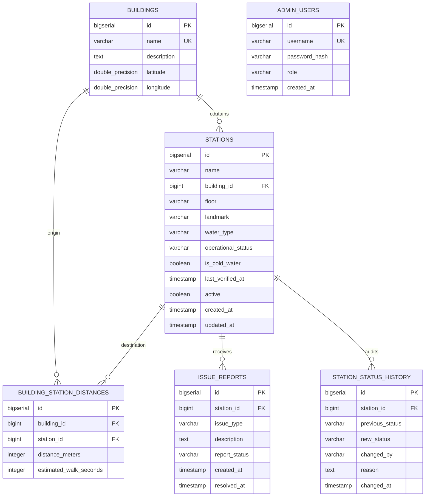

# RefillMap — Smart Campus Water Refill Locator

> **Tagline:** *"Find Water. Skip Plastic."*

RefillMap is an enterprise-grade full-stack campus web application designed to help university students and faculty find the nearest functioning drinking-water refill station on campus in **under 30 seconds**.

Built with a **React 18 + Vite + Tailwind CSS** frontend and a robust **Spring Boot 3.3.5 + Java 21 LTS + PostgreSQL** backend, RefillMap bridges crowdsourced incident reporting with official facilities maintenance workflows.

---

## 📌 Problem Statement & Solution

* **The Problem:** University campuses feature dozens of water fountains and bottle refill stations, but students frequently encounter units that are empty, undergoing maintenance, or suffering from low water pressure. Frustrated students resort to buying single-use bottled water, generating plastic waste and unnecessary expense.
* **The Solution:** RefillMap provides real-time location-based recommendations for the nearest **functioning** refill station based on the student's starting building and temperature preference (*Cold* vs *Ambient*). It equips physical stations with scannable QR codes for instant lookup and empowers students to log incident tickets that facilities administrators verify through a protected management console.

---

## 🌟 Full-Stack Architecture & Features

```
┌─────────────────────────────────────────────────────────────────┐
│                       React 18 Frontend                         │
│  Vite • Tailwind CSS • Lucide Icons • Axios • QRCode Generator  │
└────────────────────────────────▲────────────────────────────────┘
                                 │ HTTP / REST APIs (JSON + JWT Bearer)
┌────────────────────────────────▼────────────────────────────────┐
│                   Spring Boot 3.3.5 Backend                     │
│        Java 21 LTS • Spring Security • Spring Data JPA          │
│          Bean Validation • Flyway Migrations • JJWT             │
└────────────────────────────────▲────────────────────────────────┘
                                 │ JDBC / SQL
┌────────────────────────────────▼────────────────────────────────┐
│                    PostgreSQL 16 Database                       │
│       Tables: buildings, stations, issue_reports,               │
│       station_status_history, admin_users, distances            │
└─────────────────────────────────────────────────────────────────┘
```

### 1. Frontend & Backend Integration (Dual-Mode Resilience)
- **Axios Reusable Service Layer:** Located in [`src/services/api.js`](file:///c:/Users/Sidhk/OneDrive/Desktop/refillmap/src/services/api.js) with JWT interceptors for admin routes.
- **Dual-Mode Operation:** Automatically detects backend availability at `VITE_API_BASE_URL` (`http://localhost:8080/api`). If the Spring Boot service is active, it loads live PostgreSQL data and submits reports to the API. If offline, it smoothly switches to **Demonstration Fallback Mode** with an informative banner.
- **Zero Fake Success:** Failed backend requests are never silently replaced with fake success notifications.

### 2. Nearest Station Recommendation Engine
- **Walking Distance Calculations:** Calculates walking distance relative to the selected building using configurable campus route matrices.
- **Maintenance Exclusion:** Stations undergoing maintenance or with unknown status are strictly excluded from the primary recommendation.
- **Preference Matching & Explanations:** Allows selecting *Any*, *Cold Water*, or *Normal Water*. If a student's preference cannot be fulfilled nearby, the system explains why and suggests the closest viable alternative.

### 3. QR Code Quick-Scan Access & Deep Linking
- **Stable URLs:** Every campus dispenser has a persistent URL (e.g. `/?station=2` or `/stations/2`).
- **Dynamic QR Generation:** Built-in QR modal ([`src/components/QrCodeModal.jsx`](file:///c:/Users/Sidhk/OneDrive/Desktop/refillmap/src/components/QrCodeModal.jsx)) enables downloading high-resolution PNG QR stickers or copying links for physical dispenser labelling.
- **Instant Deep Linking:** Scanning a QR code immediately focuses and opens that station's profile, health specs, and reporting tool.
- **Cross-Device Wi-Fi Guidance:** Includes a clear reminder that mobile device testing requires using local network IP (e.g. `http://192.168.x.x:5173`) instead of `localhost`.

### 4. Protected Facilities Administrator Console
- **Spring Security & JWT Auth:** Administrative endpoints (`/api/admin/**`, `POST /api/stations`, `PATCH /api/stations/{id}/status`, `PATCH /api/reports/{id}/status`) are protected by BCrypt password hashing and stateless JWT Bearer authorization.
- **Real-Time Facilities Dashboard:** Live cards displaying total stations, operational count, maintenance count, pending tickets, and resolved tickets.
- **Station Hardware CRUD:** Add new campus refill stations, edit details, and deactivate retired hardware.
- **Audit Logging:** Every status transition records the administrator username, timestamp, and inspection notes in `station_status_history`.

### 5. Issue Verification & Resolution Workflow
Crowdsourced student reports never automatically mutate official station statuses:

```
Student submits report (Status: PENDING)
        ↓
Incident ticket logged in PostgreSQL
        ↓
Facilities administrator reviews ticket in Console
        ↓
Administrator verifies issue on-site
        ↓
Administrator transitions station status (with mandatory audit log)
        ↓
Ticket marked RESOLVED or DISMISSED
        ↓
Students immediately see the verified station status
```

### 6. Status Freshness & Inspection Transparency
- **Explicit Telemetry Disclaimer:** Station profiles clearly communicate that records reflect the latest facilities physical inspection, not automated live sensor telemetry.
- **Inspection Timestamps:** Shows exact verification date/time and inspector identity.
- **Pending Ticket Badges:** Displays the number of student reports currently awaiting facilities review.
- **Health Probing:** Dedicated `/api/health` probe reporting service state and PostgreSQL database connection validity.

---

## 💻 Technology Stack

| Layer | Technologies |
| :--- | :--- |
| **Frontend** | React 18, Vite 5, Tailwind CSS 3, Lucide React Icons, Axios 1.7, QRCode 1.5 |
| **Backend** | Java 21 LTS, Spring Boot 3.3.5, Spring Web, Spring Data JPA, Spring Security |
| **Security** | JJWT (Java JWT 0.12.6), BCrypt Password Hashing, Stateless Session, CORS |
| **Database** | PostgreSQL 16 (Production/Dev), Flyway Database Migrations, H2 (Automated Tests) |
| **DevOps** | Docker, Docker Compose, Multi-stage Dockerfile, Maven Wrapper (`mvnw.cmd`) |

---

## 🗄️ Database Design



---

## 📂 Project Directory Structure

```
refillmap/
├── backend/                                # Spring Boot Java 21 Backend
│   ├── src/main/java/com/refillmap/
│   │   ├── config/                         # SecurityConfig, JwtTokenProvider, Cors
│   │   ├── controller/                     # REST API Endpoints (Auth, Station, Building, Reports, Admin, Health)
│   │   ├── dto/                            # Request & Response Data Transfer Objects
│   │   ├── entity/                         # JPA Entities (Building, Station, IssueReport, etc.)
│   │   ├── exception/                      # GlobalExceptionHandler and custom exceptions
│   │   ├── repository/                     # Spring Data JPA Repositories
│   │   └── service/                        # NearestRecommendationService, StationService, etc.
│   ├── src/main/resources/
│   │   ├── db/migration/                   # Flyway Migrations (V1 Schema, V2 Demo Seeds)
│   │   └── application.yml                 # PostgreSQL & JWT Configuration
│   ├── src/test/                           # Integration Tests (MockMvc, Security, Recommendations)
│   ├── Dockerfile                          # Multi-stage production container build
│   └── pom.xml                             # Maven Project Object Model
├── src/                                    # React 18 Frontend
│   ├── components/                         # Modular UI Components (Navbar, Cards, Modals, AdminDashboard)
│   ├── data/                               # Demonstrations datasets & Building definitions
│   ├── services/                           # Axios api.js & recommendationService.js
│   ├── utils/                              # distance.js calculations & formatting
│   ├── App.jsx                             # Application coordinator & URL deep-linking
│   └── main.jsx                            # React entrypoint
├── docker-compose.yml                      # Full-stack container orchestration
├── test-suite.js                           # Frontend automated test suite (43 assertions)
├── tailwind.config.js                      # Tailwind styling configuration
├── vite.config.js                          # Vite configuration
└── README.md                               # Project documentation
```

---

## 🔑 Default Administrator Credentials

| Role | Username | Password | Access Level |
| :--- | :--- | :--- | :--- |
| **Facilities Admin** | `admin` | `AdminPassword123!` | Full administrative console, status updates, station CRUD, issue verification |

---

## 📡 REST API Reference

### Public Endpoints (Students & Campus Community)

| Method | Endpoint | Description |
| :--- | :--- | :--- |
| `GET` | `/api/health` | System health check (service status & DB connection probe) |
| `GET` | `/api/buildings` | List all configured campus buildings |
| `GET` | `/api/buildings/{id}` | Get specific building details |
| `GET` | `/api/stations` | Paginated list of active stations (filters: `buildingId`, `status`, `waterType`) |
| `GET` | `/api/stations/{id}` | Station profile and specifications |
| `GET` | `/api/stations/{id}/history` | Official status change audit history log |
| `GET` | `/api/stations/nearest` | Calculate nearest functioning station with preference matching |
| `POST` | `/api/reports` | Submit a crowdsourced issue report (`PENDING`) |
| `POST` | `/api/auth/login` | Authenticate administrator and receive JWT token |

### Protected Endpoints (`Authorization: Bearer <token>`)

| Method | Endpoint | Description |
| :--- | :--- | :--- |
| `GET` | `/api/admin/dashboard` | Dashboard metrics (station counts, ticket counts, recent changes) |
| `POST` | `/api/stations` | Register a new campus refill station |
| `PUT` | `/api/stations/{id}` | Update station hardware information |
| `PATCH` | `/api/stations/{id}/status` | Officially update operational status with audit log |
| `DELETE` | `/api/stations/{id}` | Soft-deactivate a station |
| `GET` | `/api/reports` | Paginated review of student incident reports |
| `GET` | `/api/reports/{id}` | View full report details |
| `PATCH` | `/api/reports/{id}/status` | Transition report (`VERIFIED`, `RESOLVED`, `DISMISSED`) & optional station status |

---

## 🛠️ Local Execution & Installation

### Prerequisites
- **Java 21 LTS**
- **Node.js 18+ & npm**
- **PostgreSQL 14+** (Optional: backend includes automated H2 in-memory fallback for local testing without DB setup)

### 1. Running the Spring Boot Backend

```bash
cd backend

# Option A: Zero configuration with in-memory H2 database (Pre-seeded with demo data & admin)
..\mvnw.cmd spring-boot:run -Dspring-boot.run.profiles=test

# Option B: Run with PostgreSQL (Ensure database 'refillmap_db' exists on port 5432)
..\mvnw.cmd spring-boot:run
```

The REST API will start at `http://localhost:8080/api`.

### 2. Running the React Frontend

In the root project directory:

```bash
# 1. Install frontend dependencies
npm install

# 2. Run the development server
npm run dev
```

Visit `http://localhost:5173` in your browser.

---

## 🌐 Environment Variables

### Frontend (`.env`)
```ini
VITE_API_BASE_URL=http://localhost:8080/api
VITE_APP_URL=http://localhost:5173
```

### Backend (`backend/src/main/resources/application.yml` / System Env)
```ini
PORT=8080
DB_HOST=localhost
DB_PORT=5432
DB_NAME=refillmap_db
DB_USERNAME=postgres
DB_PASSWORD=postgres
JWT_SECRET=404E635266556A586E3272357538782F413F4428472B4B6250645367566B5970
JWT_EXPIRATION_MS=86400000
CORS_ALLOWED_ORIGINS=http://localhost:5173,http://127.0.0.1:5173,http://localhost:3000
```

---

## 🧪 Automated Testing

### Frontend Test Suite (43 Assertions)
Verifies distance calculations, maintenance exclusion, temperature preference fallbacks, search/filter logic, edge cases, and issue categories:

```bash
node test-suite.js
```

### Backend Test Suite (20 Integration Tests)
Verifies Spring Security JWT authorization, public vs admin endpoints, recommendation algorithm, station CRUD, health probes, and report verification:

```bash
cd backend
..\mvnw.cmd test
```

### Production Build Verification
```bash
npm run build
```

---

## 🚢 Production Deployment Guide

### 1. Automated Docker Compose Deployment
```bash
# Spins up PostgreSQL 16 container and Spring Boot backend container:
docker-compose up -d --build
```

### 2. Manual Production Build & Packaging
```bash
# 1. Package backend fat jar
cd backend
..\mvnw.cmd clean package -DskipTests
# Output: backend/target/refillmap-backend-1.0.0.jar

# 2. Build production frontend assets
cd ..
npm run build
# Output: dist/ (HTML, CSS, JS bundle optimized for Nginx/CDN)
```

### 3. Production Deployment Checklist
- [x] Run Flyway database migrations (`V1__init_schema.sql`, `V2__seed_demo_data.sql`).
- [x] Set secure, strong `JWT_SECRET` (at least 256 bits).
- [x] Restrict `CORS_ALLOWED_ORIGINS` to the exact production domain(s).
- [x] Enforce TLS / HTTPS at the reverse proxy (Nginx, Traefik, or Cloudflare).
- [x] Point health checks to `GET /api/health`.
- [x] Configure persistent database volumes with regular backups.

---

## 👥 Demonstration Data Notice
Demonstration stations, buildings, and walking distances are simulated for campus testing and user interface evaluation. Official campus locations and statuses are maintained through university facilities management.
